# Deep Fake Detection System

A comprehensive AI-powered deepfake detection system that analyzes images and text using ensemble learning with multiple state-of-the-art machine learning models. The system leverages Azure Functions for serverless deployment and Azure Agent Framework for concurrent model execution.

## ⚠️ Disclaimer

**IMPORTANT - READ CAREFULLY BEFORE USE:**

- **Proof of Concept Only**: This is a proof-of-concept implementation and is **NOT production-ready**. It is intended for educational and research purposes only.

- **User Responsibility**: Users are **solely responsible** for how this code is used, modified, deployed, and shared. Any use of this system is at your own risk.

- **No Liability**: The owner/creator of this repository is **NOT responsible** under any law and in any country for:
  - How this code is used
  - What purposes it is used for
  - Where and how it gets deployed or shared
  - Any consequences arising from its use

- **Purpose**: The **ONLY** purpose of this repository is to showcase an approach for detecting deepfake content (images and text). Nothing less, nothing more.

- **No Warranty**: This software is provided "AS IS" without warranty of any kind, express or implied.

By using this code, you acknowledge that you have read, understood, and agree to these terms.

## Model Architecture



The system uses a concurrent workflow pattern where:
1. Multiple detection agents run in parallel
2. Each agent loads models from cache or Azure Blob Storage
3. Results are aggregated using a Logistic Regression meta-classifier
4. Final predictions include ensemble voting and detailed reports

## Supported Models

### Image Models

| Model Name | Architecture | Description | Source |
|------------|-------------|-------------|--------|
| **NoEscape** | DINOv2 + EfficientNet | Full Nonescape model for high-accuracy detection | Custom |
| **Prithiv V1** | SigLIP | SigLIP-based deepfake detector (default) | HuggingFace |
| **DimaVit** | Vision Transformer (ViT) | Vision Transformer based detector | HuggingFace |
| **DimaVit V2 Fine-tuned** | Vision Transformer (ViT) | Fine-tuned ViT on deepfake dataset for enhanced detection | Fine-tuned |
| **Organika SDXL** | Custom | Specialized for Stable Diffusion generated images | HuggingFace |
| **Prithiv Open Deepfake** | SigLIP | Open source SigLIP-based deepfake detector | HuggingFace |
| **MobileNetV2** | MobileNetV2 | Lightweight model fine-tuned for deepfake detection | Fine-tuned |
| **MobileNetV2 CNN** | MobileNetV2 + CNN | Lightweight with custom CNN layers for detection | Fine-tuned |
| **CNN V3** | DenseNet201 | DenseNet201-based model for subtle artifact detection | Fine-tuned |

### Text Models

| Model Name | Architecture | Description | Training Data |
|------------|-------------|-------------|---------------|
| **CharCNN** | Character-level CNN | Character-level convolutional neural network for text detection | Custom training |
| **BERT-ML** | BERT + Logistic Regression | BERT embeddings with ML classifier | Custom training |
| **DistilBERT** | DistilBERT + Logistic Regression | Efficient BERT variant with ML classifier | Custom training |
| **BoW-ML** | TF-IDF + Logistic Regression | Bag of Words with traditional ML approach | Custom training |

## Quick Start

## Folder Structure

```
Deep_Fake_Detection/
├── Agents/                          # Agent Framework implementation
│   ├── ImageAgents/                 # Image detection agents and workflows
│   └── TextAgents/                  # Text detection agents and workflows
├── Assets/                          # Documentation assets (diagrams, images)
├── function_app.py                  # Azure Functions entry point
├── host.json                        # Azure Functions host configuration
├── imagedetectionlib/               # Image detection library
│   └── model_registry.py            # Image model registry and metadata
├── textdetectionlib/                # Text detection library
│   └── model_registry.py            # Text model registry and metadata
├── outputModel/                     # Output data models
│   ├── image_detection_output_model.py
│   └── text_detection_output_model.py
├── Services/                        # Service layer implementations
│   ├── app_detect_image_agent.py    # Image detection service
│   └── app_detect_text.py           # Text detection service
├── utils/                           # Utility functions
│   ├── azure_client_pool.py         # Azure client connection pooling
│   ├── bayesian_weight_optimizer.py # Bayesian optimization for voting
│   ├── image_file_helper.py         # Image file operations
│   └── logistic_regression_voter.py # LR meta-classifier voting
├── Scripts/                         # Utility scripts
│   ├── download_*.py                # Model download scripts
│   └── upload_models_to_blob.py     # Model upload to Azure Blob
├── UI/                              # Streamlit web interface
│   └── app.py                       # Web UI application
├── requirements.txt                 # Python dependencies
├── local.settings.json              # Local development settings
└── README.md                        # This file
```

## Configuration Settings

| Key | Description | Default Value | Notes |
|-----|-------------|---------------|-------|
| `AzureWebJobsStorage` | Azure Storage connection string for Functions | `UseDevelopmentStorage=true` | Use Azurite emulator for local development |
| `FUNCTIONS_WORKER_RUNTIME` | Functions runtime language | `python` | Required for Python Azure Functions |
| `STORAGE_ACCOUNT_NAME` | Azure Storage account name for models | `deepfakemodels` | Used to download models from blob storage |
| `PYTHONWARNINGS` | Python warnings filter | `ignore` | Suppresses warning messages |
| `AzureWebJobsDisableHomepage` | Disable Functions landing page | `true` | Disables the default Azure Functions home page |
| `AZURE_FUNCTIONS_ENVIRONMENT` | Environment name | `Development` | Set to `Production` when deploying |
| `PYTHON_ENABLE_WORKER_EXTENSIONS` | Enable Python worker extensions | `0` | Disabled to avoid compatibility issues |
| `FUNCTIONS_WORKER_PROCESS_COUNT` | Number of worker processes | `1` | Increase for production scaling |

## Deployment

*This section is reserved for future deployment documentation.*

## References

### HuggingFace Model Repositories

- [Prithiv Deepfake Detector V1](https://huggingface.co/prithivMLMods/deepfake-detector-model-v1)
- [Prithiv Open Deepfake Detection](https://huggingface.co/prithivMLmods/open-deepfake-detection)
- [DimaVit Deepfake Detection](https://huggingface.co/dima806/deepfake_vs_real_image_detection)
- [Organika SDXL Detector](https://huggingface.co/Organika/sdxl-detector)
- [Transformers Library](https://huggingface.co/docs/transformers)

### Research Papers & Resources

- [Vision Transformers (ViT)](https://arxiv.org/abs/2010.11929)
- [MobileNetV2: Inverted Residuals and Linear Bottlenecks](https://arxiv.org/abs/1801.04381)
- [DenseNet: Densely Connected Convolutional Networks](https://arxiv.org/abs/1608.06993)
- [BERT: Pre-training of Deep Bidirectional Transformers](https://arxiv.org/abs/1810.04805)
- [Ensemble Methods in Machine Learning](https://link.springer.com/chapter/10.1007/3-540-45014-9_1)
- [Noisy Student Paper](https://arxiv.org/abs/1911.04252)
- [Nonescape Repository](https://github.com/aediliclabs/nonescape/tree/master)
- [SEMAFOR Analytic Catalog](https://semafor.dsri.org/analytic-catalog/)

### Azure Documentation

- [Azure Functions Python Developer Guide](https://learn.microsoft.com/azure/azure-functions/functions-reference-python)
- [Azure Agent Framework](https://learn.microsoft.com/azure/ai-studio/how-to/develop/agents)
- [Azure Blob Storage for Python](https://learn.microsoft.com/azure/storage/blobs/storage-quickstart-blobs-python)

### GitHub Repositories

- [Azure Functions Python Samples](https://github.com/Azure-Samples/azure-functions-python-samples)
- [C2PA Python Library](https://github.com/contentauth/c2pa-python)
- [DeepFace - Face Recognition Framework](https://github.com/serengil/deepface)
- [NTech-Lab DFDC Solution](https://github.com/NTech-Lab/deepfake-detection-challenge)

### Kaggle Datasets

- [Deepfake Detection Challenge Dataset](https://www.kaggle.com/c/deepfake-detection-challenge)
- [140k Real and Fake Faces](https://www.kaggle.com/datasets/xhlulu/140k-real-and-fake-faces)

## License

This project is licensed under the MIT License.

📄 [View License](./LICENSE)

---

**Built with**: Azure Functions • Azure Agent Framework • PyTorch • TensorFlow • Transformers • OpenCV

**Last Updated**: November 2025